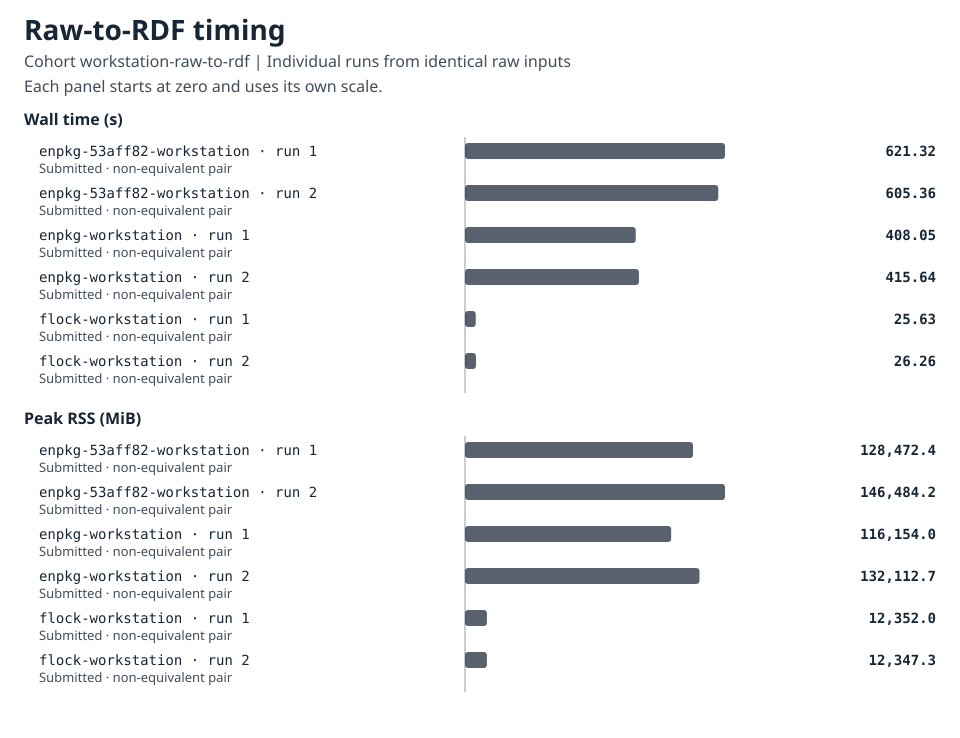
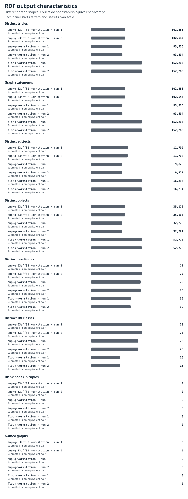

# ENPKG toy benchmark comparison

Each record contains two raw-to-RDF runs on the same canonical input. RDF equivalence compares the two outputs within a record.

| Record | Source | RDF equivalence of runs 1 and 2 | Evidence |
| --- | --- | --- | --- |
| enpkg-53aff82-workstation | Submitted | non-equivalent | [Runbook](../submissions/enpkg-53aff82-workstation/README.md) · [Record](../submissions/enpkg-53aff82-workstation/benchmark.json) |
| enpkg-workstation | Submitted | non-equivalent | [Runbook](../submissions/enpkg-workstation/README.md) · [Record](../submissions/enpkg-workstation/benchmark.json) |
| flock-workstation | Submitted | non-equivalent | [Runbook](../submissions/flock-workstation/README.md) · [Record](../submissions/flock-workstation/benchmark.json) |

## Raw-to-RDF timing

Compare individual runs within the same declared machine and protocol cohort. Each panel has its own scale.

### workstation-raw-to-rdf

## RDF output characteristics

The runbooks describe each pipeline's graph scope. Counts alone do not establish equivalent coverage.

